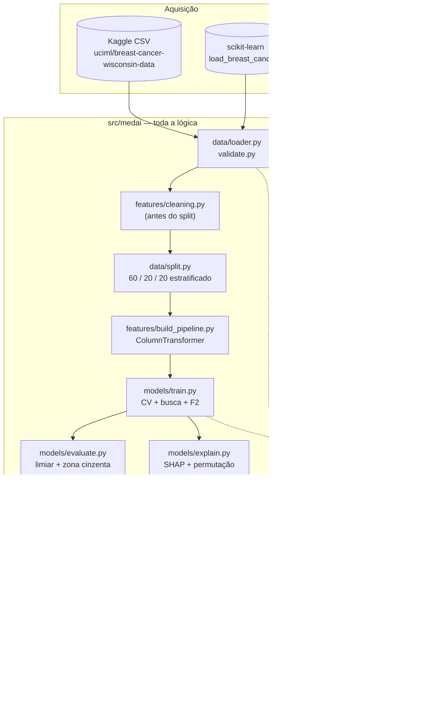

# MedAI Triage

**Sistema de apoio à triagem diagnóstica** — Hospital Universitário Santa Clara (instituição fictícia).
Classificação binária de exames de punção aspirativa por agulha fina (FNA): **maligno (1) × benigno (0)**, a partir de 30 medidas morfológicas de núcleos celulares.

`Python 3.11` · `scikit-learn 1.5.2` · `FastAPI` · `Streamlit` · `SHAP` · 168 testes · `ruff`/`black` limpos

> ### ⚠️ Aviso clínico
> **Resultado de apoio à triagem. Não constitui diagnóstico. A decisão clínica é do médico responsável.**
>
> Projeto **educacional**. Não é dispositivo médico, não possui validação clínica, validação prospectiva nem aprovação regulatória, e **não deve ser usado em decisão assistencial real**. O aviso acima é emitido em toda resposta da API e no rodapé da interface.

---

## Início rápido (Docker)

Único pré-requisito: [Docker](https://docs.docker.com/get-docker/) com Compose v2. Não é preciso Python, venv, GPU nem credencial do Kaggle.

```bash
git clone <url-do-repositorio> tech-challenge && cd tech-challenge
```

```bash
docker compose up --build
```

| Serviço | URL |
|---|---|
| Painel Streamlit | http://localhost:8501 |
| API (Swagger) | http://localhost:8000/docs |
| Health check | http://localhost:8000/health |

```bash
curl -s http://localhost:8000/health
```

O dataset é materializado **durante o build** da imagem (ver [§6](#6-dataset)) e o modelo treinado já vem versionado em `models/`. Para encerrar: `docker compose down`. Detalhes, retreino e execução sem Docker na [§7](#7-instalação).

---

## Sumário

1. [O problema e a decisão de projeto](#1-o-problema-e-a-decisão-de-projeto)
2. [Resultados verificados](#2-resultados-verificados)
3. [Arquitetura](#3-arquitetura)
4. [Como funciona — o pipeline etapa a etapa](#4-como-funciona--o-pipeline-etapa-a-etapa)
5. [Estrutura do repositório](#5-estrutura-do-repositório)
6. [Dataset](#6-dataset)
7. [Instalação](#7-instalação)
8. [Uso](#8-uso)
9. [API REST](#9-api-rest)
10. [Painel Streamlit](#10-painel-streamlit)
11. [Configuração](#11-configuração)
12. [Testes e qualidade de código](#12-testes-e-qualidade-de-código)
13. [Decisões técnicas (ADR)](#13-decisões-técnicas-adr)
14. [Reprodutibilidade](#14-reprodutibilidade)
15. [Limitações conhecidas](#15-limitações-conhecidas)
16. [Status das fases](#16-status-das-fases)
17. [Documentação e licença](#17-documentação-e-licença)

---

## 1. O problema e a decisão de projeto

| Item | Definição |
|---|---|
| **Tarefa** | Classificação binária supervisionada sobre dados tabulares |
| **Alvo** | `diagnosis` — `M` (maligno) = **classe positiva = 1**; `B` (benigno) = 0 |
| **Entrada** | 30 features numéricas contínuas (10 medidas × 3 agregações: `_mean`, `_se`, `_worst`) |
| **Amostras** | 569 (212 malignas = 37,3%; 357 benignas = 62,7%) — desbalanceamento **moderado** |
| **Métrica primária** | **Recall da classe maligna** |
| **Critério de seleção** | **F2-score** (recall pesa 4× precisão) |
| **Saída** | Probabilidade de malignidade + faixa de decisão + explicação SHAP |

### Por que recall, e não accuracy

Um `DummyClassifier` que responde "benigno" para todo mundo atinge **62,7% de accuracy** neste dataset e **recall zero** na classe maligna. Accuracy é reportada, nunca usada para decidir nada.

Os dois erros não são comparáveis:

- **Falso negativo** = câncer não sinalizado → atraso diagnóstico, dano potencialmente irreversível.
- **Falso positivo** = exame confirmatório a mais → custo, ansiedade, reversível.

### Por que F2 e não recall puro na seleção

Otimizar recall isoladamente **elege o modelo degenerado**: classificar tudo como maligno dá recall 1,0 com precisão 0,37 e utilidade nula. O F2 pondera recall quatro vezes mais que precisão — o degenerado obtém F2 = 0,746 contra 0,963 de um modelo útil. A prioridade clínica é preservada **sem** aceitar a solução trivial. A garantia de recall alto vem depois, do ajuste de limiar, que é onde ela pertence por ser decisão de operação. Ver [ADR-014](docs/DECISOES_TECNICAS.md).

### Três salvaguardas de desenho

1. **Limiar deslocado para 0,158** (não 0,5), calibrado para alvo de recall de 98%.
2. **Zona cinzenta [0,30 – 0,70]** — probabilidades nessa faixa recebem `zona_cinzenta_revisao_medica` em vez de rótulo binário.
3. **Probabilidade sempre exibida**, nunca só o rótulo — principal mitigação de *automation bias* que a interface pode oferecer.

---

## 2. Resultados verificados

**Modelo campeão: Regressão Logística** (`C=0.5`, `penalty=l2`, `class_weight=balanced`, `solver=lbfgs`), feature set completo (30 features).

O conjunto de teste (114 amostras, 42 malignas) foi aberto **uma única vez**, na Fase 6. Nenhuma decisão de modelo, hiperparâmetro, feature set ou limiar foi tomada olhando para ele.

### Desempenho no teste

| Métrica | Limiar operacional (0,158) | Limiar padrão (0,5) |
|---|---:|---:|
| **Recall (maligno)** | **0,9762** | 0,9762 |
| Precisão | 0,8723 | 0,9762 |
| F1 | 0,9213 | 0,9762 |
| Especificidade | 0,9167 | 0,9861 |
| Accuracy | 0,9386 | 0,9825 |
| ROC-AUC | 0,9970 | — |
| PR-AUC | 0,9956 | — |
| Brier | 0,0193 | — |
| **Falsos negativos** | **1** | 1 |
| Falsos positivos | 6 | 1 |

Fonte: [`reports/metrics/test_metrics.json`](reports/metrics/test_metrics.json) — números reproduzidos a partir do artefato versionado.

### Comparação entre modelos (teste, limiar 0,5)

| Modelo | Recall | Precisão | F1 | Accuracy | ROC-AUC | FN |
|---|---:|---:|---:|---:|---:|---:|
| `dummy` (piso) | 0,0000 | 0,0000 | 0,0000 | 0,6316 | 0,5000 | 42 |
| **`logistic_regression`** | **0,9762** | 0,9762 | 0,9762 | 0,9825 | 0,9967 | **1** |
| `random_forest` | 0,9286 | 1,0000 | 0,9630 | 0,9737 | 0,9980 | 3 |
| `xgboost` | 0,9286 | 1,0000 | 0,9630 | 0,9737 | 0,9881 | 3 |
| `knn` | 0,8810 | 0,9737 | 0,9250 | 0,9474 | 0,9823 | 5 |
| `decision_tree` | 0,8810 | 0,9250 | 0,9024 | 0,9298 | 0,9552 | 5 |

Fonte: [`reports/metrics/teste_comparacao_modelos.csv`](reports/metrics/teste_comparacao_modelos.csv).

| Matriz de confusão (limiar 0,158) | Curvas ROC e PR |
|---|---|
|  |  |

### Honestidade estatística

Com 42 casos malignos no teste, **um único erro vale 2,4 pontos percentuais de recall**. Diferenças de 2 a 3 pontos entre modelos estão abaixo da resolução da medida.

O protocolo completo (split → treino → limiar → avaliação) foi repetido com **5 sementes** (`42, 7, 13, 2024, 99`):

| Métrica | Média | Desvio | Mínimo | Máximo |
|---|---:|---:|---:|---:|
| **Recall** | **0,9810** | 0,0199 | 0,9524 | 1,0000 |
| Precisão | 0,8707 | 0,0356 | 0,8367 | 0,9302 |
| ROC-AUC | 0,9970 | 0,0014 | 0,9957 | 0,9990 |

A resposta honesta a "qual é o recall deste modelo" é **≈98%, com incerteza de ±2 pontos**. O alvo de 98% **não** foi atingido na semente usada (97,62%) — a estimativa fora de fold era otimista.

**O limiar deslocado não comprou nada nesta divisão.** Em 0,158 e em 0,5 o resultado é o mesmo falso negativo; o corte baixo apenas acrescentou 5 falsos positivos. O caso maligno perdido tem probabilidade 0,1166, abaixo dos dois limiares — nenhum corte acima disso o capturaria. Nas cinco sementes, porém, o limiar ajustado reduz os falsos negativos de 8 para 4 (recall médio 98,1% contra 96,2%) ao preço de 31 falsos positivos contra 5. O deslocamento compra sensibilidade **em expectativa, não em cada divisão** — detalhamento em [RELATORIO_TECNICO.md §9.2](RELATORIO_TECNICO.md).

### Interpretabilidade

SHAP agrupado por grandeza medida — a leitura clinicamente correta, porque features redundantes (`radius`/`perimeter`/`area` são geometricamente a mesma coisa) dividem crédito entre si na leitura individual:

| Grupo | Contribuição absoluta |
|---|---:|
| tamanho (radius/perimeter/area) | 3,85 |
| irregularidade (concavity/compactness/concave points) | 3,13 |
| textura | 1,57 |
| simetria | 0,85 |
| suavidade | 0,61 |
| dimensão fractal | 0,49 |


24 figuras em [`reports/figures/`](reports/figures/) · análise completa em [RELATORIO_TECNICO.md](RELATORIO_TECNICO.md).

---

## 3. Arquitetura



**Princípios estruturais:**

- **Toda a lógica vive em `src/medai/`.** Notebooks importam, executam e narram — não contêm lógica. Isso elimina o descompasso treino/produção.
- **A UI não carrega o modelo** — conversa com a API por HTTP. Se o painel responde, o contrato REST está provado.
- **O artefato serializado é o pipeline inteiro** (`ColumnTransformer` + estimador), nunca só o estimador. Um estimador sozinho exigiria reconstruir o pré-processamento na API, com risco de divergência silenciosa ([ADR-005](docs/DECISOES_TECNICAS.md)).
- **Caminhos e hiperparâmetros vêm de YAML**, nunca hardcoded.

---

## 4. Como funciona — o pipeline etapa a etapa

### 4.1 Aquisição e validação — `data/loader.py`, `data/validate.py`

Duas rotas, na ordem de preferência: **CSV do Kaggle** se presente (tem as colunas `id` e `Unnamed: 32`, que exercitam a limpeza) → **Kaggle CLI** se houver credencial → **`sklearn.datasets.load_breast_cancer()`** como fallback sem credencial, mesma origem UCI ([ADR-002](docs/DECISOES_TECNICAS.md)).

> **Armadilha tratada:** em `load_breast_cancer()`, `target == 0` é *maligno* e `target == 1` é *benigno* — o **inverso** da convenção deste projeto. Usar `target` direto inverteria precision e recall sem erro aparente. O tratamento está no loader e é coberto por dois testes independentes.

A validação de schema roda em **todo** carregamento: colunas esperadas, tipos, faixas, cardinalidade do alvo.

### 4.2 Limpeza — `features/cleaning.py`

Restrita a operações que **não aprendem nada dos dados**, por isso pode rodar antes do split: descartar colunas (`id`, `Unnamed: 32`), mapear o rótulo, remover duplicatas, converter zeros fisiologicamente impossíveis em `NaN` (não se aplica a este dataset; aplica-se ao Pima).

**Outliers não são removidos** — em dados clínicos, o outlier costuma ser o caso patológico de interesse ([ADR-007](docs/DECISOES_TECNICAS.md)).

### 4.3 Particionamento — `data/split.py`

**60% treino / 20% validação / 20% teste**, estratificado, `random_state=42`. Dentro do treino, `StratifiedKFold` de 5 folds.

> **Regra inviolável:** nenhum `fit` antes do split. Imputador, scaler e seleção de features são ajustados **só no treino**. Com 569 amostras, vazamento é fácil de cometer e difícil de notar.

### 4.4 Pré-processamento — `features/build_pipeline.py`

`ColumnTransformer` com dois ramos: numérico (`SimpleImputer(median)` → `StandardScaler`) e categórico (`SimpleImputer(most_frequent)` → `OneHotEncoder`). O ramo categórico fica vazio neste dataset e existe para a parametrização generalizar.

### 4.5 Correlação e multicolinearidade — `features/correlation.py`

Pearson, Spearman e **VIF**. A multicolinearidade aqui não é achado empírico, é **consequência geométrica**: `perimeter ≈ 2πr` e `area ≈ πr²`. Pares acima de |ρ| = 0,95 são redundantes por construção.

Resultado: dois feature sets ([ADR-009](docs/DECISOES_TECNICAS.md)) — **completo** (30) e **reduzido** (sem as redundâncias geométricas). Ambos entram no protocolo experimental; o completo venceu.

### 4.6 Experimentos — `models/train.py`, `models/registry.py`

6 modelos × 2 feature sets = 12 experimentos, cada um com busca de hiperparâmetros (`GridSearchCV` ou `RandomizedSearchCV`) em CV de 5 folds no treino. Catálogo em `registry.py`: `dummy`, `logistic_regression`, `decision_tree`, `knn`, `random_forest`, `xgboost`.

Cada execução é registrada em [`reports/experiments.csv`](reports/experiments.csv) com timestamp, hash da config, semente, métricas de CV e hiperparâmetros vencedores ([ADR-013](docs/DECISOES_TECNICAS.md) — CSV, não MLflow).

Estimadores são criados com `n_jobs=1`; o paralelismo fica a cargo da busca. Paralelizar nos dois níveis causa superalocação de threads e deixa o treino **mais lento**.

### 4.7 Ponto de operação — `models/evaluate.py`, `models/calibrate.py`

O limiar é escolhido por **predições fora de fold em treino + validação** (455 amostras), buscando o menor corte que atinja recall de 98%: **0,158**. Na validação isolada, o mesmo procedimento dá 0,180.

Calibração foi avaliada e **descartada**: o Brier do modelo original já é melhor que o do calibrado ([ADR-015](docs/DECISOES_TECNICAS.md)). Regressão logística produz probabilidades naturalmente calibradas.

Três faixas de saída: `benigno` (p < 0,30), `zona_cinzenta_revisao_medica` (0,30 ≤ p ≤ 0,70), `maligno` (p > 0,70) — combinadas com a decisão binária no limiar operacional.

### 4.8 Serialização — `models/persist.py`

Grava o pipeline completo em `.joblib` e um `metadata.json` com: lista **ordenada** de features esperadas, limiar e sua origem, estatísticas por feature (mín/p01/mediana/p99/máx), métricas de CV e validação, hiperparâmetros, hashes de config e dados, e versões de Python/sklearn/numpy/pandas/joblib.

A API valida a entrada contra esse contrato na inicialização e **compara as versões**, avisando em caso de divergência.

### 4.9 Avaliação final — `scripts/evaluate_model.py`

Único ponto do projeto que abre o conjunto de teste. Produz matriz de confusão, curvas ROC/PR, comparação entre modelos, coeficientes, permutation importance, SHAP global/agrupado/beeswarm, SHAP local para TP/TN/FP/FN, análise de erros e robustez multi-semente.

---

## 5. Estrutura do repositório

```
tech-challenge/
├── configs/
│   ├── breast_cancer.yaml        # dataset principal
│   └── diabetes.yaml             # bônus: mesmo pipeline, Pima Diabetes
├── data/                         # raw/interim/processed/external — nunca versionados
├── docs/
│   ├── PLANEJAMENTO.md           # plano mestre, 11 fases
│   ├── CHECKLIST_REQUISITOS.md   # rastreabilidade requisito → artefato
│   ├── DECISOES_TECNICAS.md      # 15 ADRs com o *porquê* de cada escolha
│   ├── AMBIENTE.md               # hardware e versões verificadas
│   └── dicionario_dados.md       # as 30 features, com leitura clínica
├── models/
│   ├── medai_breast_cancer_wisconsin_v1.joblib   # pipeline completo (versionado)
│   └── metadata.json                             # contrato do artefato
├── notebooks/                    # 01 EDA · 02 pré-proc · 03 modelagem · 04 avaliação
├── reports/
│   ├── figures/                  # 24 PNGs, 150 dpi
│   ├── metrics/                  # JSON/CSV de resultados
│   └── experiments.csv           # rastreamento de experimentos
├── scripts/
│   ├── download_data.py          # materializa o dataset
│   ├── make_report_assets.py     # figuras e tabelas de EDA
│   └── evaluate_model.py         # Fase 6 — abre o teste
├── src/medai/
│   ├── config.py                 # YAML → pydantic, com hash da config
│   ├── logging_conf.py           # log texto ou JSON estruturado
│   ├── data/                     # loader · validate · split · explore
│   ├── features/                 # cleaning · build_pipeline · correlation
│   ├── models/                   # registry · train · evaluate · calibrate
│   │                             # explain · persist · plots · robustez
│   ├── api/                      # main · schemas · service · deps
│   ├── ui/app.py                 # painel Streamlit
│   └── vision/                   # Fase 8 opcional (não implementada)
├── tests/                        # 168 testes
├── Dockerfile · docker-compose.yml · .dockerignore
├── Makefile · activate.sh · pyproject.toml
├── requirements.txt              # freeze Linux
├── requirements-mac.txt          # freeze macOS (sem nvidia-nccl-cu12)
└── RELATORIO_TECNICO.md          # o relatório exigido pelo desafio
```

---

## 6. Dataset

**Breast Cancer Wisconsin (Diagnostic)** — Universidade de Wisconsin, anos 1990.

| | |
|---|---|
| Origem primária | [UCI ML Repository #17](https://archive.ics.uci.edu/dataset/17/breast+cancer+wisconsin+diagnostic) |
| Espelho | [Kaggle — `uciml/breast-cancer-wisconsin-data`](https://www.kaggle.com/datasets/uciml/breast-cancer-wisconsin-data) |
| Sem credencial | `sklearn.datasets.load_breast_cancer()` |
| Dimensões | 569 × 30 features + 1 alvo binário · sem valores ausentes |
| Dicionário | [docs/dicionario_dados.md](docs/dicionario_dados.md) |

**Como os dados foram produzidos:** cada linha é uma punção aspirativa por agulha fina de massa mamária. A amostra é fotografada e o software `Xcyt` delimita contornos de núcleos celulares; as features são medidas geométricas e de textura desses contornos.

**Implicação central:** as features **não são extraídas da imagem bruta por este sistema**. Elas pressupõem que um profissional já realizou a punção e que um software já segmentou os núcleos. O modelo automatiza o *julgamento* sobre medidas prontas, não a *extração* das medidas.

As 10 medidas de base (`radius`, `texture`, `perimeter`, `area`, `smoothness`, `compactness`, `concavity`, `concave points`, `symmetry`, `fractal_dimension`) aparecem três vezes: `_mean` (tendência central), `_se` (heterogeneidade entre núcleos) e `_worst` (média dos 3 maiores — o achado mais alarmante).

### Como obter o dataset

O CSV **não é versionado** (`data/raw/` está no `.gitignore`), mas é reproduzível por três caminhos, do mais simples ao mais manual:

**1. Automático (recomendado, sem credencial).** `scripts/download_data.py` grava `data/raw/breast_cancer_wisconsin.csv` a partir do loader do scikit-learn — a mesma base da UCI — e valida o resultado (569 linhas, 212 malignos = 37,3%). No Docker isso já acontece no `docker build`.

```bash
make data
```

**2. Kaggle** (traz as colunas `id` e `Unnamed: 32`, que exercitam a etapa de limpeza). Requer `~/.kaggle/kaggle.json` ou as variáveis `KAGGLE_USERNAME` / `KAGGLE_KEY`; o mesmo `make data` usa essa rota automaticamente quando a credencial existe.

```bash
kaggle datasets download -d uciml/breast-cancer-wisconsin-data --unzip -p data/raw
```

**3. Download manual direto da UCI** (sem conta):

- Link: https://archive.ics.uci.edu/static/public/17/breast+cancer+wisconsin+diagnostic.zip
- Página do dataset: https://archive.ics.uci.edu/dataset/17/breast+cancer+wisconsin+diagnostic

O arquivo da UCI (`wdbc.data`) não tem cabeçalho nem o mesmo schema do Kaggle. Para usá-lo com o pipeline, prefira as rotas 1 ou 2, que já entregam o schema canônico esperado por `configs/breast_cancer.yaml`.

---

## 7. Instalação

### 7.1 Pré-requisitos

| Item | Requisito | Observação |
|---|---|---|
| Python | **3.11** | `scikit-learn 1.5.2` e `joblib 1.6.0` são críticos: o `.joblib` não carrega confiavelmente sob outra versão menor de sklearn |
| RAM | ≥ 4 GB | o treino completo leva poucos minutos em CPU |
| GPU | **não necessária** | nenhum código pressupõe CUDA ([ADR-011](docs/DECISOES_TECNICAS.md)) |
| macOS | `brew install libomp` | **necessário para o `xgboost`**; sem ele o import falha com `Library not loaded: @rpath/libomp.dylib` |
| Kaggle | opcional | só para a rota CSV; o fallback `sklearn` dispensa credencial |

### 7.2 Rota A — `make` (ambiente com `python3.11` no PATH)

```bash
make setup
```

```bash
source activate.sh
```

`make setup` cria `.venv/`, instala o pacote em modo editável com o extra `[all]` (viz, models, explain, serve, dev) e registra o `nbstripout` nos atributos do Git.

`activate.sh` **precisa ser carregado com `source`** — executado, rodaria em subshell e não afetaria seu terminal. Ele ativa o venv, carrega o `.env` quando existir (sem sobrescrever variáveis já definidas no shell), fixa `PYTHONHASHSEED` e limita `OMP_NUM_THREADS=4` para que BLAS não dispute os núcleos com o `n_jobs` do scikit-learn.

### 7.3 Rota B — `uv` (macOS / sem `python3.11` no PATH)

O ambiente atual foi montado assim. `make setup` falha se `python3.11` não existir no PATH.

```bash
uv venv --python 3.11 .venv
```

```bash
VIRTUAL_ENV=.venv uv pip install -r requirements-mac.txt
```

```bash
VIRTUAL_ENV=.venv uv pip install -e . --no-deps
```

O terceiro comando é obrigatório: `requirements*.txt` são `pip freeze --exclude-editable`, portanto **não** contêm o pacote `medai`. Sem ele, qualquer `import medai` falha com `ModuleNotFoundError`.

```bash
source .venv/bin/activate
```

### 7.4 Rota C — Docker (recomendada)

Arquivos: [`Dockerfile`](Dockerfile), [`docker-compose.yml`](docker-compose.yml) e [`.dockerignore`](.dockerignore).

```bash
docker compose up --build
```

```bash
docker compose up --build -d
```

O segundo comando sobe em segundo plano. Os alvos `make docker-build`, `make docker-up` e `make docker-down` são atalhos para os mesmos comandos.

**O que a imagem faz**

- **Multi-stage** sobre `python:3.11-slim`: o estágio `builder` instala as dependências num venv; o `runtime` leva só o venv, o código, `configs/`, `scripts/` e `models/`.
- **Versões fixas:** `requirements.txt` entra como *constraints* (`pip install -c`), então cada pacote resolvido tem a versão exata do freeze (`scikit-learn 1.5.2` é crítico para carregar o `.joblib`), sem instalar JupyterLab, pytest ou ruff.
- **Dataset na build:** `scripts/download_data.py` roda no `docker build` e grava o CSV dentro da imagem. A API precisa dele para reconstruir o conjunto de treino que serve de referência ao SHAP; sem ele `/explain` ficaria desabilitado.
- **Usuário não-root** (`medai`, UID 1000), `HEALTHCHECK` em `/health` e log em JSON (`MEDAI_LOG_FORMAT=json`).
- Uma só imagem para API e UI: o `docker-compose.yml` escolhe o comando.

**Serviços do compose**

| Serviço | Porta | Observação |
|---|---|---|
| `api` | 8000 | monta `./models` em **somente leitura**; healthcheck em `/health` |
| `ui` | 8501 | `depends_on: api` com `service_healthy`; usa `MEDAI_API_URL=http://api:8000` |
| `train` | — | perfil opcional, executa o treino completo |

**Retreinar dentro do container**

```bash
docker compose --profile train run --rm train
```

> **Atenção:** o serviço `train` grava em `./models` e `./reports` do host, **sobrescrevendo o artefato versionado** (`.joblib`, `metadata.json`) e `reports/experiments.csv`. Para descartar o resultado: `git checkout -- models reports/experiments.csv`.

**Build para outra arquitetura** (ex.: gerar `linux/amd64` a partir de um Mac Apple Silicon): `docker buildx build --platform linux/amd64 -t medai-triage .`

**Tamanho:** a imagem tem ≈ 1,7 GB. A maior parte vem de `shap`/`numba`/`llvmlite` e do `xgboost`, que no Linux x86_64 arrasta `nvidia-nccl-cu12` (inútil sem GPU, mas dependência declarada do wheel).

**Verificado em** Docker 29.9.2 (Docker Desktop, macOS arm64): build, `docker compose up`, `GET /health`, `POST /explain` e `GET :8501/_stcore/health` responderam corretamente, e o perfil `train` concluiu o treino. Não foi testado em Linux x86_64 nem em máquina sem cache de build.

---

## 8. Uso

### 8.1 Comandos disponíveis

```bash
make help
```

| Alvo | O que faz |
|---|---|
| `make setup` | Cria o venv e instala as dependências |
| `make data` | Materializa o dataset em `data/raw/` (Kaggle → sklearn) |
| `make eda` | Gera as 10 figuras de exploração em `reports/figures/` |
| `make train` | Roda os 12 experimentos, seleciona o campeão, ajusta o limiar e serializa o artefato |
| `make evaluate` | **Abre o conjunto de teste**; gera métricas e as figuras de interpretabilidade |
| `make api` | FastAPI em `:8000` com recarregamento automático |
| `make ui` | Streamlit em `:8501` |
| `make notebook` | JupyterLab apontado para `notebooks/` |
| `make test` | `pytest` com cobertura |
| `make lint` | `ruff check` + `black --check` |
| `make format` | Corrige e formata automaticamente |
| `make freeze` | Congela as versões em `requirements.lock.txt` |
| `make clean` | Remove caches (preserva dados e modelos) |

Todos aceitam `CONFIG=` para trocar de dataset, e `API_PORT=` / `UI_PORT=` para trocar de porta.

### 8.2 Do zero ao serviço rodando

O artefato treinado **já está versionado** (2,9 KB), então o caminho mais curto é subir a API direto:

```bash
make api
```

Para reproduzir tudo a partir dos dados:

```bash
make data && make eda && make train && make evaluate
```

Depois, em dois terminais:

```bash
make api
```

```bash
make ui
```

A UI em `http://localhost:8501` consulta a API em `http://localhost:8000` (ajustável por `MEDAI_API_URL`).

### 8.3 Notebooks

Quatro notebooks, executáveis na ordem. Eles **narram** — toda a lógica vem de `src/medai/`.

| Notebook | Fase | Conteúdo |
|---|---|---|
| [`01_exploracao_dados.ipynb`](notebooks/01_exploracao_dados.ipynb) | 2 | Estrutura, estatísticas descritivas, distribuições, separabilidade (Cohen's d), outliers, PCA |
| [`02_preprocessamento_correlacao.ipynb`](notebooks/02_preprocessamento_correlacao.ipynb) | 3 | Limpeza, split, `ColumnTransformer`, Pearson/Spearman, VIF, definição dos feature sets |
| [`03_modelagem_experimentos.ipynb`](notebooks/03_modelagem_experimentos.ipynb) | 4 | 6 modelos × 2 feature sets, seleção por F2, ajuste de limiar |
| [`04_avaliacao_interpretabilidade.ipynb`](notebooks/04_avaliacao_interpretabilidade.ipynb) | 6 | Teste, SHAP global e local, análise de erros, robustez multi-semente |

As saídas são removidas no commit pelo `nbstripout`.

### 8.4 Rodar o mesmo pipeline sobre outro dataset

Todo o pipeline é parametrizado por YAML — **nenhuma mudança de código** é necessária:

```bash
make train CONFIG=configs/diabetes.yaml
```

`configs/diabetes.yaml` descreve o Pima Indians Diabetes (768 amostras, 8 features, alvo `Outcome`) e exercita recursos que o dataset principal não usa: `zeros_impossiveis` (glicose = 0 é ausência disfarçada de zero) e imputação efetiva. Exige baixar o CSV antes (`make data CONFIG=configs/diabetes.yaml`).

---

## 9. API REST

```bash
make api
```

Documentação interativa: **http://localhost:8000/docs** (Swagger) e `/redoc`.

| Método | Rota | Descrição |
|---|---|---|
| `GET` | `/health` | Liveness. Responde **mesmo sem modelo carregado**, com `status: degradado` — para que o orquestrador relate "não pronto" em vez de reiniciar em laço |
| `GET` | `/model/info` | Metadados do artefato: algoritmo, data de treino, features, limiar e sua origem, métricas de validação, versões e **limitações conhecidas** |
| `POST` | `/predict` | Um exame → predição, probabilidade, faixa, recomendação |
| `POST` | `/explain?top=N` | Idem, com contribuições SHAP individuais e **agrupadas** |
| `POST` | `/predict/batch` | Lista de exames → fila ordenada por suspeição decrescente |
| `POST` | `/predict/csv` | Upload de CSV (uma linha por exame) → mesma fila |

### Características do contrato

- **O schema de entrada é construído em tempo de execução a partir de `metadata.json`**, não escrito à mão. Duplicar a lista de features criaria duas fontes da verdade que divergiriam no primeiro retreino.
- Nomes de coluna com espaço (`concave points_mean`) ganham **alias**: tanto `concave points_mean` quanto `concave_points_mean` funcionam.
- Toda feature é `float` com `ge=0` — medida morfológica negativa indica corrupção de dados.
- **Não há limite superior.** Valores acima do máximo visto no treino são **sinalizados em `avisos`, não recusados**: um tumor excepcionalmente grande é exatamente o caso que o sistema precisa processar.
- Erro de contrato vira **422 legível**, não 500.
- Toda predição é registrada em log estruturado **sem dados identificáveis** (probabilidade, faixa, latência, versão do modelo) — a base para medir concordância com o laudo final e detectar deriva.

### Exemplo verificado

```bash
curl -s -X POST http://localhost:8000/predict \
  -H 'Content-Type: application/json' \
  -d '{"radius_mean": 17.99, "texture_mean": 10.38, "perimeter_mean": 122.8, "area_mean": 1001.0, "smoothness_mean": 0.1184, "compactness_mean": 0.2776, "concavity_mean": 0.3001, "concave points_mean": 0.1471, "symmetry_mean": 0.2419, "fractal_dimension_mean": 0.07871, "radius_se": 1.095, "texture_se": 0.9053, "perimeter_se": 8.589, "area_se": 153.4, "smoothness_se": 0.006399, "compactness_se": 0.04904, "concavity_se": 0.05373, "concave points_se": 0.01587, "symmetry_se": 0.03003, "fractal_dimension_se": 0.006193, "radius_worst": 25.38, "texture_worst": 17.33, "perimeter_worst": 184.6, "area_worst": 2019.0, "smoothness_worst": 0.1622, "compactness_worst": 0.6656, "concavity_worst": 0.7119, "concave points_worst": 0.2654, "symmetry_worst": 0.4601, "fractal_dimension_worst": 0.1189}'
```

Resposta:

```json
{
  "predicao": 1,
  "rotulo": "maligno",
  "probabilidade_malignidade": 1.0,
  "faixa_decisao": "maligno",
  "recomendacao": "Priorizar na fila de revisão.",
  "limiar_usado": 0.158,
  "versao_modelo": "breast_cancer_wisconsin_v1",
  "avisos": [],
  "aviso_clinico": "Resultado de apoio à triagem. Não constitui diagnóstico. A decisão clínica é do médico responsável."
}
```

> Esta amostra pertence ao dataset original e pode ter sido vista no treino. Serve para demonstrar o **contrato**, não o desempenho — para desempenho, ver [Resultados verificados](#2-resultados-verificados).

`POST /explain?top=3` sobre o mesmo exame devolve, além do acima, as contribuições em log-odds — `valor_base: 0.564`, `symmetry_worst: +2.265`, `radius_se: +2.230`, `concave points_mean: +1.817` — e o agrupamento por grandeza, que é a leitura clinicamente correta.

---

## 10. Painel Streamlit

```bash
make ui
```

Três abas em `http://localhost:8501`:

1. **Caso individual** — formulário com as 30 medidas, pré-dimensionado pelas faixas observadas no treino (vindas de `/model/info`). Resultado em cartão colorido por faixa, com a **probabilidade sempre visível** e a explicação SHAP agrupada ao lado.
2. **Triagem de fila** — upload de CSV ou colagem de várias linhas; devolve a fila ordenada por suspeição, com resumo por faixa.
3. **Sobre o modelo** — algoritmo, data de treino, limiar e sua origem, métricas de validação, versões e a lista completa de **limitações conhecidas**, incluindo a taxa de falsos negativos.

Decisões de desenho que não são estéticas:

- "87%" convida à avaliação; "maligno" convida à concordância. Por isso a probabilidade é exibida, não só o rótulo.
- A explicação aparece **junto** da predição, agrupada por grandeza — a leitura individual do SHAP diria "textura foi decisiva" quando o fator real é tamanho nuclear.
- As limitações são expostas na interface. Esconder a taxa de falsos negativos tornaria a ferramenta mais confiável do que ela merece ser.

---

## 11. Configuração

### 11.1 Variáveis de ambiente

Copie [`.env.example`](.env.example) para `.env` e ajuste. Variáveis já definidas no shell têm precedência.

| Variável | Padrão | Lida por | Efeito |
|---|---|---|---|
| `MEDAI_LOG_LEVEL` | `INFO` | `logging_conf.py` | `DEBUG` / `INFO` / `WARNING` / `ERROR` |
| `MEDAI_LOG_FORMAT` | `text` | `logging_conf.py` | `text` legível ou `json` estruturado |
| `MEDAI_API_URL` | `http://localhost:8000` | `ui/app.py` | Endereço da API usado pelo painel |
| `MEDAI_CONFIG` | `configs/breast_cancer.yaml` | `api/deps.py` | Qual YAML a API carrega no startup |
| `KAGGLE_USERNAME` / `KAGGLE_KEY` | — | `scripts/download_data.py` | Alternativa a `~/.kaggle/kaggle.json` |

> **Nota de precisão:** `.env.example` também lista `MEDAI_MODEL_PATH` e `MEDAI_RANDOM_STATE`. **Nenhuma das duas é lida pelo código Python.** O caminho do artefato vem do YAML + `metadata.json`; a semente vem de `configs/*.yaml`. `MEDAI_RANDOM_STATE` é usada apenas pelo `activate.sh`, para definir `PYTHONHASHSEED`.

### 11.2 Configuração do pipeline (YAML)

[`configs/breast_cancer.yaml`](configs/breast_cancer.yaml) é validado por pydantic com `extra = "forbid"` — chave desconhecida é erro, não silêncio. Cada carregamento calcula um **hash SHA-256 truncado** da config, registrado junto das métricas para que cada resultado seja rastreável à configuração que o produziu.

Blocos: `dataset` (origem, alvo, classe positiva, colunas a descartar), `limpeza`, `split`, `correlacao`, `modelagem` (catálogo, métrica, `beta_fscore`, `recall_minimo_alvo`, `zona_cinzenta`, `sementes_robustez`) e `caminhos`.

---

## 12. Testes e qualidade de código

```bash
make test
```

```bash
make lint
```

**Estado verificado neste ambiente (macOS arm64, Python 3.11.17):**

- `pytest`: **167 passaram, 1 falhou** em 36 s.
  A única falha é `tests/test_models.py::test_estimadores_usam_n_jobs_unitario`, por causa do ambiente, não do código: o `xgboost` não importa sem a `libomp` do macOS (`dlopen … Library not loaded: @rpath/libomp.dylib`). `brew install libomp` resolve.
- `ruff check src tests scripts`: **All checks passed!**
- `black --check src tests scripts`: **45 arquivos, nenhuma mudança necessária.**

Cobertura de testes por área: dados e validação, limpeza e pipeline, split e ausência de vazamento, registry e treino, calibração, persistência e contrato do artefato, explicabilidade, visualização, logging, config e API (via `TestClient`).

Marcadores: `-m "not slow"` pula os testes que treinam modelos; `-m integration` roda os que exigem artefato ou dados em disco.

Convenções do projeto: type hints em toda função pública, docstrings explicando **por que** e não *o que*, `random_state` fixo em todo lugar que sorteia, figuras em PNG 150 dpi com nome descritivo, e toda função em `src/medai/` nasce com teste em `tests/`.

---

## 13. Decisões técnicas (ADR)

Cada decisão está registrada em [docs/DECISOES_TECNICAS.md](docs/DECISOES_TECNICAS.md) com contexto, alternativas consideradas e consequências.

| ADR | Decisão |
|---|---|
| 001 | Dataset principal: Breast Cancer Wisconsin (Diagnostic) |
| 002 | Dupla rota de aquisição (sklearn + Kaggle) |
| 003 | Recall da classe maligna como métrica primária |
| 004 | Split 60/20/20 com CV aninhada no treino |
| 005 | Pipeline sklearn serializado inteiro, nunca só o estimador |
| 006 | Notebooks sem lógica de negócio |
| 007 | Manter outliers |
| 008 | Calibração de probabilidade e zona cinzenta |
| 009 | Dois feature sets (completo de 30 × reduzido) |
| 010 | Entrega como API + UI, não apenas notebooks |
| 011 | CNN como fase opcional, CPU-only (sem CUDA na máquina) |
| 012 | Sem flip horizontal em raio-X — inverte a lateralidade anatômica |
| 013 | Rastreamento de experimentos em CSV, não MLflow |
| 014 | Seleção de modelo por F2, não por recall puro |
| 015 | Manter as probabilidades originais — não recalibrar |

---

## 14. Reprodutibilidade

- **`random_state = 42`** fixo e registrado em config, metadados e `experiments.csv`.
- **`PYTHONHASHSEED`** fixado pelo `activate.sh` — o hash de string do Python é aleatório por processo e pode afetar ordem de iteração.
- **Hash da config e hash dos dados** gravados em `models/metadata.json` e em cada linha de `reports/experiments.csv`.
- **Versões registradas no artefato** e comparadas pela API na inicialização. Divergência de versão menor de scikit-learn gera aviso.
- **Versões do treino atual:** Python 3.11.16, scikit-learn 1.5.2, numpy 2.1.3, pandas 2.2.3, joblib 1.6.0.
- Nenhuma credencial é necessária para rodar o projeto do zero — a rota `sklearn` dispensa Kaggle.

> [docs/AMBIENTE.md](docs/AMBIENTE.md) descreve a máquina original de desenvolvimento (Ubuntu 26.04, 12 núcleos, sem CUDA) e aponta para `requirements.lock.txt`. **Esse arquivo não existe mais** no estado atual da árvore: foi substituído por `requirements.txt` (freeze Linux) e `requirements-mac.txt` (freeze macOS). O ambiente atual é macOS arm64 com Python 3.11.17 gerenciado por `uv`.

---

## 15. Limitações conhecidas

Expostas também em `GET /model/info` e na aba "Sobre o modelo" da UI — quem integra o sistema precisa delas tanto quanto das métricas.

1. Treinado com **569 amostras de uma única instituição** (Universidade de Wisconsin, anos 1990). Validade externa não verificada.
2. Recebe **medidas morfológicas já extraídas** por profissional; não analisa a imagem bruta.
3. O dataset **não contém variáveis demográficas**, o que torna **impossível auditar viés por subgrupo**.
4. Aproximadamente **1 em cada 42 casos malignos não é sinalizado** (recall ≈ 98%, com incerteza de ±2 pontos).
5. Cerca de **1 em cada 8 casos sinalizados é benigno** (precisão ≈ 87% no limiar operacional).
6. **Sem validação prospectiva nem aprovação regulatória.** Uso educacional.
7. O alvo declarado de recall de 98% **não foi atingido** na semente avaliada (97,62%) — a estimativa fora de fold era otimista.

Discussão crítica completa — incluindo automation bias, risco regulatório e o que uma implantação real exigiria — em [RELATORIO_TECNICO.md §13](RELATORIO_TECNICO.md).

---

## 16. Status das fases

| Fase | Entregável | Status |
|---|---|---|
| 0 | Ambiente verificado | ✅ |
| 1 | Problema definido e dados obtidos | ✅ |
| 2 | EDA — 10 figuras + estatísticas + discussão | ✅ |
| 3 | Pré-processamento, correlação, VIF, feature sets | ✅ |
| 4 | Modelagem — 12 experimentos, seleção, limiar | ✅ |
| 5 | Treino final e serialização do artefato | ✅ |
| 6 | Avaliação no teste + SHAP + robustez | ✅ |
| 7 | API FastAPI + UI Streamlit | ✅ |
| 8 | **EXTRA opcional** — CNN para pneumonia + Grad-CAM | ⬜ não iniciada |
| 9 | **Dockerfile + docker-compose** | ✅ |
| 10 | README + relatório técnico | 🔄 em andamento |

Rastreabilidade requisito → artefato em [docs/CHECKLIST_REQUISITOS.md](docs/CHECKLIST_REQUISITOS.md).

---

## 17. Documentação e licença

| Documento | Conteúdo |
|---|---|
| [RELATORIO_TECNICO.md](RELATORIO_TECNICO.md) | Relatório técnico completo — 17 seções, do contexto clínico à discussão crítica |
| [docs/PLANEJAMENTO.md](docs/PLANEJAMENTO.md) | Plano mestre, 11 fases, arquitetura alvo |
| [docs/DECISOES_TECNICAS.md](docs/DECISOES_TECNICAS.md) | 15 ADRs com o *porquê* de cada escolha |
| [docs/CHECKLIST_REQUISITOS.md](docs/CHECKLIST_REQUISITOS.md) | Rastreabilidade requisito → artefato |
| [docs/AMBIENTE.md](docs/AMBIENTE.md) | Hardware e versões verificadas |
| [docs/dicionario_dados.md](docs/dicionario_dados.md) | As 30 features, com leitura clínica |

**Licença:** MIT. **Autor:** Rodrigo Lomardo.

Código e identificadores em inglês; documentação, comentários e notebooks em português — convenção registrada em [CLAUDE.md](CLAUDE.md).

---

> **Lembrete final.** Toda saída deste sistema é sugestão de triagem. O diagnóstico final é sempre do médico. Projeto educacional, sem validação clínica — não usar em decisão assistencial real.
