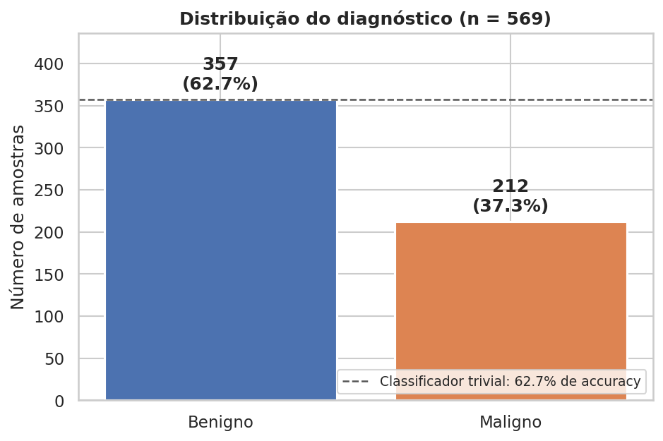
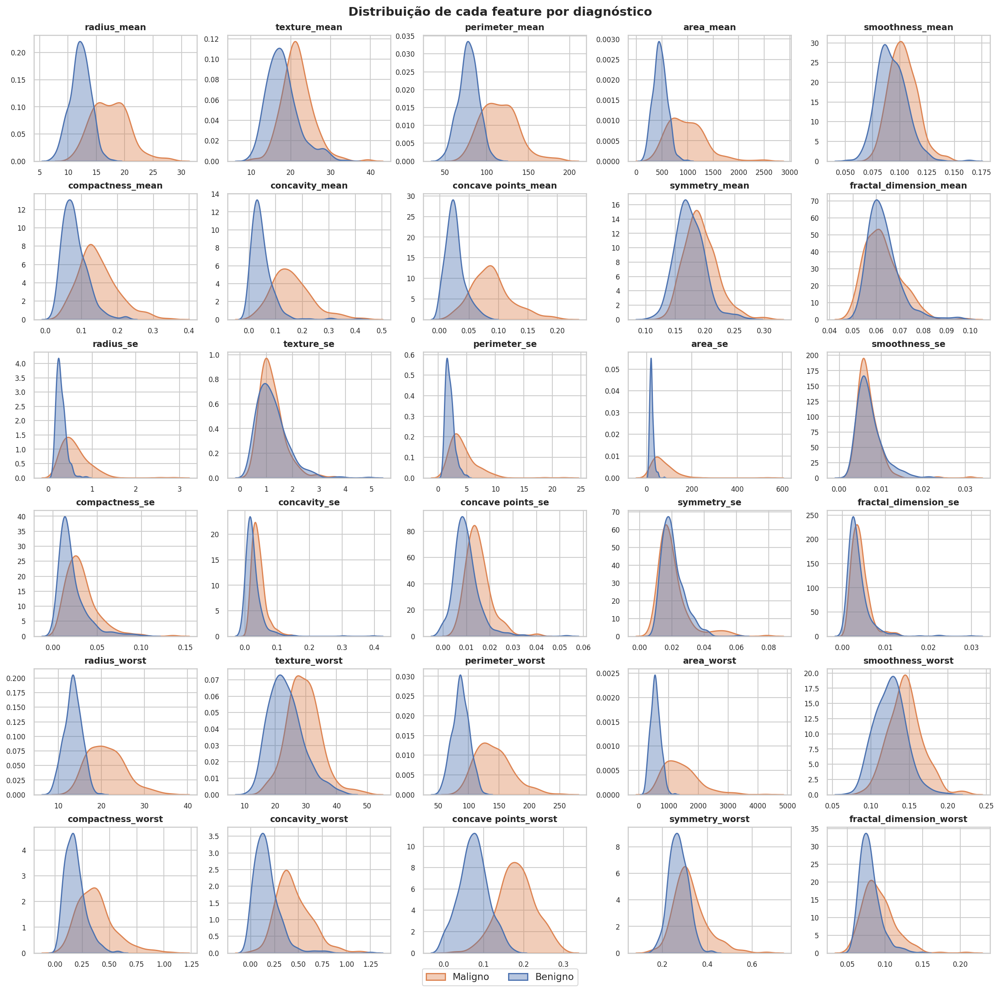
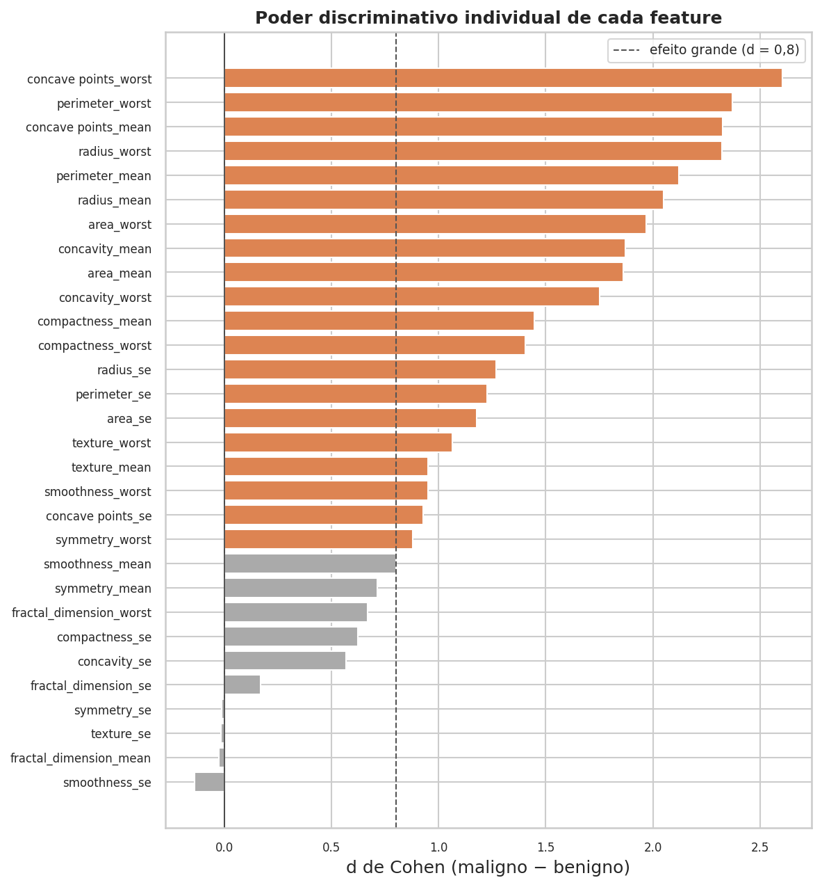
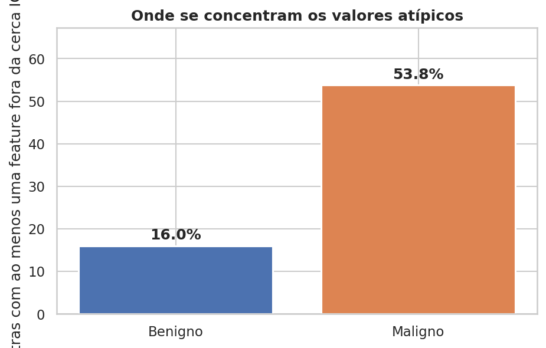
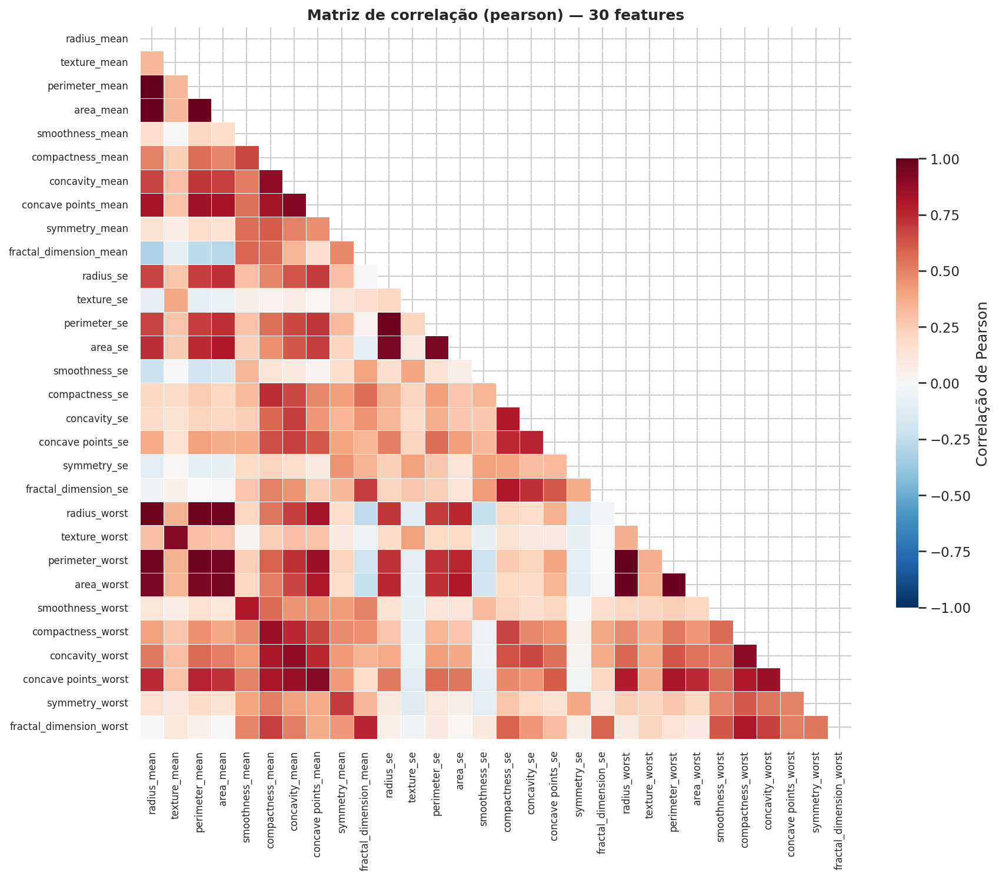
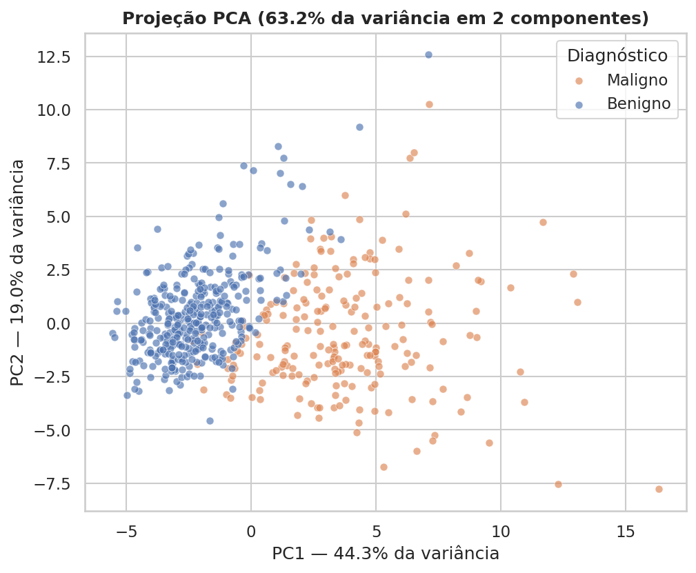

# Relatório Técnico — MedAI Triage

**Sistema Inteligente de Suporte à Triagem Diagnóstica**
Hospital Universitário Santa Clara (instituição fictícia)

Autor: Rodrigo Lomardo · Documento em construção — seções preenchidas conforme as fases avançam.

> **Aviso.** Projeto educacional. Não é dispositivo médico, não possui validação clínica nem aprovação regulatória, e não deve ser usado em decisão assistencial real.

---

## Índice

1. [Sumário executivo](#1-sumário-executivo) — *pendente (Fase 10)*
2. [Problema e contexto clínico](#2-problema-e-contexto-clínico) ✅
3. [Dataset: origem, dicionário e limitações](#3-dataset-origem-dicionário-e-limitações) ✅
4. [Exploração de dados](#4-exploração-de-dados) ✅
5. [Estratégias de pré-processamento](#5-estratégias-de-pré-processamento) ✅
6. [Correlação e multicolinearidade](#6-correlação-e-multicolinearidade) ✅
7. [Modelos utilizados e justificativa](#7-modelos-utilizados-e-justificativa) ✅
8. [Protocolo experimental](#8-protocolo-experimental) ✅
9. Resultados — *pendente (Fase 6)*
10. Escolha da métrica e justificativa clínica — *pendente (Fase 6)*
11. Interpretabilidade — *pendente (Fase 6)*
12. Discussão crítica: o modelo serve na prática? — *pendente (Fase 6)*
13. Limitações e riscos — *pendente (Fase 6)*
14. Trabalhos futuros — *pendente (Fase 10)*
15. Anexo: visão computacional — *opcional (Fase 8)*
16. Referências

---

## 1. Sumário executivo

*A ser escrito na Fase 10, quando houver resultados a sumarizar.*

---

## 2. Problema e contexto clínico

### 2.1 O cenário

O Hospital Universitário Santa Clara enfrenta um gargalo de triagem. O volume de exames cresce mais rápido que a equipe capaz de laudá-los: radiografias, tomografias, ressonâncias, prontuários digitalizados e lâminas de citopatologia se acumulam em fila. A consequência não é apenas demora — é que a demora se distribui de forma **indiferente à gravidade**. Um caso de alta suspeição aguarda o mesmo tempo que um caso trivial, porque a fila é cronológica e não há como saber o que é urgente antes de examinar.

Há ainda o fator fadiga. Revisão em volume alto, sob pressão de tempo, degrada a acurácia humana — e o erro que mais custa nesse contexto é o de deixar passar.

### 2.2 O que este sistema se propõe a fazer

Produzir, para cada exame na fila, uma **estimativa de probabilidade de malignidade**, acompanhada da explicação de quais medidas sustentaram aquela estimativa. Com isso, a fila deixa de ser cronológica e passa a ser ordenada por suspeição.

O que o sistema **não** faz, e precisa estar dito sem ambiguidade: não emite diagnóstico, não substitui o laudo e não dispensa a avaliação humana de nenhum caso. Todo exame continua sendo revisto por um profissional; o que muda é a ordem e a informação disponível no momento da revisão.

### 2.3 Formulação técnica

| Aspecto | Definição |
|---|---|
| Tipo de problema | Classificação binária supervisionada |
| Entrada | 30 medidas morfológicas de núcleos celulares (punção aspirativa por agulha fina) |
| Saída | Probabilidade calibrada de malignidade + faixa de decisão + atribuição SHAP por feature |
| Classe positiva | **Maligno (`M` → 1)** |
| Classe negativa | Benigno (`B` → 0) |
| Usuário | Equipe de citopatologia e triagem |
| Decisão apoiada | Priorização da fila de revisão |
| Decisão **não** apoiada | Diagnóstico, conduta terapêutica, alta |

### 2.4 A assimetria de custo — a decisão que organiza o projeto

Os dois erros possíveis não são equivalentes, e essa é a premissa da qual decorrem quase todas as escolhas técnicas seguintes.

| Erro | O que acontece | Custo |
|---|---|---|
| **Falso negativo** — maligno classificado como benigno | O caso é despriorizado na fila. O diagnóstico de câncer atrasa. | **Alto e potencialmente irreversível.** Em oncologia, tempo é prognóstico. |
| **Falso positivo** — benigno classificado como maligno | O caso sobe na fila e é revisto antes. Possível exame confirmatório. | **Baixo.** Tempo profissional e ansiedade do paciente. |

Três consequências diretas:

1. **A métrica primária é o recall da classe maligna**, não a accuracy. Accuracy trata os dois erros como equivalentes, e o classificador trivial que responde sempre "benigno" já acerta 62,7% dos casos.
2. **O limiar de decisão não é 0,5.** Ele é escolhido na validação para atingir recall ≥ 0,98, aceitando a perda de precisão que isso impõe.
3. **Casos incertos não recebem rótulo binário.** Probabilidades em faixa intermediária são sinalizadas como "revisão médica prioritária" — o sistema admite não saber em vez de forçar uma resposta.

### 2.5 Onde o médico permanece no circuito

A exigência de que o diagnóstico final seja sempre humano não é uma ressalva no rodapé do README; ela está implementada:

- a saída é **probabilidade calibrada**, não rótulo — a diferença entre "87%" e "maligno" é a diferença entre informar e decidir;
- a explicação SHAP acompanha cada predição, para que o profissional possa discordar com base em algo;
- a **zona cinzenta** encaminha os casos incertos em vez de classificá-los;
- toda predição é registrada em log de auditoria;
- o aviso clínico é centralizado em [`medai.AVISO_CLINICO`](src/medai/__init__.py) e aparece em toda resposta da API e na UI.

O risco que essas medidas endereçam é o **automation bias**: a tendência documentada de profissionais concordarem com a sugestão da máquina mesmo quando ela está errada. Um sistema que exibe apenas um rótulo o agrava; um que exibe incerteza e justificativa o atenua.

---

## 3. Dataset: origem, dicionário e limitações

### 3.1 Escolha

**Breast Cancer Wisconsin (Diagnostic)** — 569 amostras, 30 features numéricas, alvo binário. Dicionário completo em [`docs/dicionario_dados.md`](docs/dicionario_dados.md).

A escolha, entre as bases oferecidas, é justificada no [ADR-001](docs/DECISOES_TECNICAS.md): a multicolinearidade severa e previsível entre `radius`, `perimeter` e `area` torna a análise de correlação uma etapa com consequência real de modelagem, em vez de um heatmap decorativo, e o custo assimétrico de erro em oncologia dá fundamento clínico à escolha de recall como métrica primária.

### 3.2 Aquisição

Duas rotas, implementadas em [`scripts/download_data.py`](scripts/download_data.py) e descritas no [ADR-002](docs/DECISOES_TECNICAS.md):

- **CSV do Kaggle**, quando há credencial. Traz a coluna `id` e a coluna fantasma `Unnamed: 32` (100% nula), que exercitam a limpeza.
- **`sklearn.datasets.load_breast_cancer()`** como fallback. Mesma origem UCI, sem credencial — garante que o projeto roda em qualquer máquina e no Docker.

As duas produzem o mesmo schema canônico, de modo que o restante do pipeline não depende de qual foi usada.

### 3.3 Uma armadilha tratada na origem

No scikit-learn, `target == 0` é **maligno** e `target == 1` é benigno — o inverso da convenção deste projeto. Usar o alvo diretamente inverteria precision e recall silenciosamente: nenhuma exceção, nenhum aviso, e um modelo que pareceria excelente enquanto otimizava exatamente a métrica errada.

O tratamento está no carregador e é protegido por duas travas independentes nos testes: a contagem de classes (212/357) e uma verificação clínica — tumores malignos têm `area_mean` maior que benignos. Se o rótulo inverter, as duas falham.

### 3.4 Limitações que acompanham estes dados

Registradas aqui porque condicionam o que o modelo pode legitimamente prometer, e retomadas na discussão crítica da Fase 6:

| Limitação | Consequência |
|---|---|
| **Features já extraídas por profissional.** O modelo recebe medidas prontas de uma lâmina já preparada e segmentada. | A automação é do *julgamento*, não da *extração*. O ganho de tempo é menor do que "IA analisa exames" sugere. |
| **569 amostras, instituição única** (Universidade de Wisconsin). | Validade externa desconhecida para outra população, outro equipamento, outro protocolo de preparo. |
| **Coletado nos anos 1990.** | Técnica de imagem e critérios citológicos mudaram em três décadas. |
| **Sem variáveis demográficas.** | Impossível auditar viés por idade, etnia ou condição socioeconômica — e um modelo não auditável quanto a viés não deveria operar em saúde. |
| **Conjunto de teste de ~114 amostras.** | Cada erro vale ~0,9 ponto percentual. Diferenças pequenas entre modelos são ruído; por isso a Fase 6 reporta intervalos sobre múltiplas sementes, não números pontuais. |

---

## 4. Exploração de dados

Notebook: [`notebooks/01_exploracao_dados.ipynb`](notebooks/01_exploracao_dados.ipynb) · Figuras: `reports/figures/01–10` · Tabelas: `reports/metrics/eda_*.csv`

### 4.1 Estrutura da base

569 linhas × 31 colunas: 30 features `float64` e um alvo categórico. **Nenhum valor ausente, nenhuma duplicata.** 165,7 KB em memória.

A ausência de ausentes simplifica a Fase 3, mas o tamanho é a restrição que condiciona toda a interpretação dos resultados: com ~114 amostras no teste, **cada erro vale 0,9 ponto percentual**. Qualquer diferença de desempenho abaixo de ~2 pontos entre dois modelos está dentro do ruído amostral, e tratá-la como real seria superinterpretação. É por isso que a Fase 6 reporta média ± desvio sobre cinco sementes em vez de um número por modelo.

### 4.2 Distribuição do alvo

| Classe | Contagem | Proporção |
|---|---:|---:|
| Benigno (`B`) | 357 | 62,7% |
| **Maligno (`M`)** | **212** | **37,3%** |

O desbalanceamento é **moderado**. Duas conclusões:

**Sobre a métrica.** O classificador que responde sempre "benigno" obtém **62,7% de accuracy** sem olhar para nenhuma feature — e **recall zero na classe maligna**, deixando passar os 212 cânceres. Accuracy alta, utilidade clínica negativa. Nenhuma métrica que premie esse comportamento pode orientar a seleção de modelo neste problema.

**Sobre reamostragem.** 37,3% não justifica SMOTE nem undersampling. Gerar amostras sintéticas por interpolação de casos oncológicos reais traz risco concreto — o modelo pode aprender artefatos do interpolador em vez de padrões clínicos — sem benefício correspondente nesta faixa de desbalanceamento. O que se exige é **estratificação nos splits**, e `class_weight='balanced'` entra como variante a testar, não como correção obrigatória.

### 4.3 Estatísticas descritivas

As features ocupam escalas que diferem em mais de seis ordens de magnitude: `area_worst` chega a 4.254, enquanto `fractal_dimension_se` fica na casa de 0,003. Para o KNN, que calcula distância euclidiana, isso significa que sem padronização **`area_worst` sozinha determinaria toda a vizinhança**. A padronização é obrigatória, não uma boa prática opcional.

Features mais assimétricas:

| Feature | Skew |
|---|---:|
| `area_se` | 5,45 |
| `concavity_se` | 5,11 |
| `fractal_dimension_se` | 3,92 |
| `perimeter_se` | 3,44 |
| `radius_se` | 3,09 |

Cabe uma distinção que costuma se perder: **`StandardScaler` não corrige assimetria.** Ele centra e redimensiona; uma distribuição com skew 5,45 continua com skew 5,45 depois dele. Transformação logarítmica corrigiria, mas beneficiaria apenas os modelos lineares — árvores e boosting são indiferentes a transformações monotônicas. Fica registrada como **hipótese a testar na Fase 4**, não como etapa a aplicar preventivamente.

### 4.4 Distribuições por classe

Três padrões:

1. **Separação clara** em `concave points`, `perimeter`, `radius`, `area` e `concavity`.
2. **Sobreposição quase total** em `smoothness_se`, `symmetry_se`, `texture_se` e `fractal_dimension_mean`.
3. **Caudas longas à direita** nas features `_se`.

Os boxplots e violinos (figuras 03 e 04) mostram que, mesmo nas features mais discriminantes, **as caudas das duas classes se sobrepõem**. Existem tumores benignos com medidas na faixa dos malignos. Esses casos serão os erros do modelo — e são exatamente os que mais merecem revisão humana, o que fundamenta a zona cinzenta.

Nas features `_worst`, a distribuição dos malignos é mais larga e mais deslocada. Isso é clinicamente coerente: `_worst` é a média dos três núcleos mais extremos da lâmina, e é neles que o citopatologista se apoia. Uma amostra majoritariamente normal com poucos núcleos muito alterados é suspeita — e a média simples esconderia esse achado.

### 4.5 Separabilidade individual (d de Cohen)

| Maior separabilidade | d | Sem separabilidade | d |
|---|---:|---|---:|
| `concave points_worst` | **2,60** | `fractal_dimension_se` | 0,17 |
| `perimeter_worst` | **2,37** | `symmetry_se` | −0,01 |
| `concave points_mean` | **2,33** | `texture_se` | −0,02 |
| `radius_worst` | **2,32** | `fractal_dimension_mean` | −0,03 |
| `perimeter_mean` | **2,12** | `smoothness_se` | −0,14 |

A convenção trata d = 0,8 como efeito grande; `concave points_worst` chega a 2,60. As seis primeiras posições são de `concave points`, `perimeter` ou `radius`, nas variantes `_worst` e `_mean`.

**As cinco features sem separabilidade constituem uma expectativa falsificável para a Fase 6.** Se o feature importance ou o SHAP atribuírem peso alto a `smoothness_se`, há duas leituras possíveis: ou a feature tem valor em interação (que o d de Cohen, sendo univariado, não capta), ou o modelo está aprendendo ruído. Registrar a expectativa antes de ver o resultado é o que permite distinguir os dois casos — sem isso, qualquer desfecho pareceria plausível em retrospecto.

### 4.6 Valores atípicos — e por que serão mantidos

Pelo critério IQR, `area_se` tem 65 valores fora da cerca (11,4% das amostras), `radius_se` e `perimeter_se` 38 cada. Há bastante coisa que um pipeline automatizado "limparia".

A distribuição desses atípicos entre as classes é o que decide a questão:

| Classe | Amostras com ao menos uma feature fora da cerca IQR |
|---|---:|
| Benigno | **16,0%** |
| Maligno | **53,8%** |

Mais da metade dos casos malignos é atípica, contra um sexto dos benignos. **Os valores extremos não são ruído de medição: são a manifestação da própria patologia.** Um tumor maligno é, por definição, tecido com crescimento desregulado — núcleos maiores, contornos irregulares, maior heterogeneidade. "Fora do padrão" descreve a doença.

Remover outliers por regra estatística descartaria **preferencialmente os casos que o modelo mais precisa identificar**, e o efeito seria perverso: as métricas de teste melhorariam, porque o problema ficaria artificialmente mais fácil, enquanto a utilidade clínica cairia. É uma armadilha em que um pipeline automatizado cai silenciosamente.

**Decisão (ADR-007): manter todos os valores atípicos.** A única checagem de corrupção pertinente é por valores fisicamente impossíveis — medidas geométricas negativas —, e a validação não encontrou nenhum.

### 4.7 Correlação entre features

Os blocos saturados não são achado empírico, são **consequência geométrica**: `perimeter ≈ 2πr` e `area ≈ πr²`, de modo que `radius`, `perimeter` e `area` medem a mesma grandeza em unidades diferentes, com |r| > 0,99. O trio se repete nos três sufixos — **nove features carregando essencialmente três informações**.

O dano não é de acurácia. Árvores lidam bem com redundância: escolhem uma feature, ignoram as demais. O dano é de **interpretação** — coeficientes instáveis na regressão logística, e crédito SHAP dividido entre features correlacionadas, fazendo cada uma parecer menos importante do que o grupo é. Daí a comparação entre feature sets prevista no ADR-009. A análise formal, com Spearman e VIF, é a Fase 3.

### 4.8 Separabilidade em conjunto (PCA)

Duas componentes capturam **63,2% da variância** (PC1 sozinha, 44,3%), com separação nítida ao longo de PC1.

1. **O problema é aprendível.** Separação visível em 2D sem supervisão nenhuma indica que modelos lineares já devem ir bem. Isso calibra a expectativa para a Fase 6: accuracy alta aqui é característica do dataset, não mérito do algoritmo — motivo a mais para não confundir desempenho neste benchmark com prontidão clínica.

2. **Há uma faixa de sobreposição** em torno de PC1 ≈ 0 a 2. **É ali que estarão os erros**, e é a base empírica da zona cinzenta: nessa região, a informação disponível não basta para decidir, e forçar um rótulo binário seria simular uma certeza que os dados não sustentam.

3. **A dispersão dos malignos é muito maior.** Benignos formam aglomerado compacto; malignos se espalham. Coerente com a análise de outliers: "normal" é um estado estreito, "patológico" tem muitas formas.

> **Nota metodológica.** Este PCA foi ajustado sobre o dataset inteiro, o que é aceitável porque **nenhum modelo está sendo treinado** — trata-se de visualizar estrutura. Se as componentes fossem usadas como features, o ajuste teria de se restringir ao treino, sob pena de vazamento.

### 4.9 Síntese da EDA

| Achado | Consequência para as próximas fases |
|---|---|
| 569 × 31, sem nulos nem duplicatas | Teste de ~114: reportar intervalos, não números pontuais |
| 37,3% malignos | Estratificar; **não** reamostrar |
| Classificador trivial acerta 62,7% | Accuracy rejeitada como métrica de decisão |
| Escalas variando 6 ordens de magnitude | `StandardScaler` obrigatório |
| `area_se` com skew 5,45 | Transformação log: hipótese a testar |
| `concave points_worst` com d = 2,60 | Referência para validar o SHAP |
| 5 features com \|d\| < 0,2 | Se o modelo valorizá-las, investigar |
| 53,8% dos malignos atípicos vs 16,0% dos benignos | **Manter outliers** |
| `radius`/`perimeter`/`area` com r > 0,99 | Comparar feature set completo vs reduzido |
| PCA separa, com faixa de sobreposição | Zona cinzenta tem base empírica |

---

## 5. Estratégias de pré-processamento

Notebook: [`notebooks/02_preprocessamento_correlacao.ipynb`](notebooks/02_preprocessamento_correlacao.ipynb) · Código: [`src/medai/features/`](src/medai/features/)

### 5.1 O princípio que organiza a fase

Há uma fronteira que decide se o experimento é válido: **o que aprende dos dados precisa aprender só do treino**.

A implementação respeita essa fronteira dividindo as responsabilidades em dois lugares:

| Onde | O que faz | Aprende dos dados? |
|---|---|---|
| [`cleaning.py`](src/medai/features/cleaning.py), antes do split | Descarta colunas, mapeia o rótulo, remove duplicatas, converte zeros impossíveis em NaN | **Não** |
| [`build_pipeline.py`](src/medai/features/build_pipeline.py), ajustado só no treino | Imputa, escalona, codifica | **Sim** |

Imputar a mediana antes do split, por exemplo, parece inofensivo — mas a mediana do dataset inteiro carrega informação das amostras de teste, e a estimativa final passa a ser otimista sem que nada sinalize o problema. Com 569 amostras o efeito é pequeno, o que o torna ainda mais perigoso: não aparece como anomalia, aparece como um resultado ligeiramente melhor.

### 5.2 Limpeza

**Colunas descartadas.** `id` e `Unnamed: 32`. O identificador precisa sair porque não tem significado clínico e, se a ordem de coleta correlacionar com o desfecho, o modelo aprenderia o número de registro em vez da patologia — vazamento invisível nas métricas e inútil em produção. A coluna fantasma é artefato de vírgula final no CSV do Kaggle, 100% nula.

**Zeros fisiologicamente impossíveis.** Não se aplicam a este dataset, mas a regra está implementada e configurável por YAML, porque o Pima Diabetes grava ausentes como zero em `Glucose`, `BloodPressure`, `SkinThickness`, `Insulin` e `BMI`. Tratá-los como medições reais distorce a mediana e ensina ao modelo uma fisiologia inexistente.

**Duplicatas.** Nenhuma encontrada. Seriam removidas por inflarem artificialmente o peso de uma amostra.

**Outliers: mantidos.** A opção existe na configuração, mas ligá-la lança `NotImplementedError` com a justificativa do ADR-007. A evidência está na seção 4.6: 53,8% dos casos malignos são atípicos pelo critério IQR, contra 16,0% dos benignos.

### 5.3 Particionamento

Divisão **60/20/20 estratificada**, `random_state=42`, implementada em [`split.py`](src/medai/data/split.py).

| Conjunto | n | Positivos | Desvio da base |
|---|---:|---:|---:|
| Treino | 341 | 37,2% | −0,1 pp |
| Validação | 114 | 37,7% | +0,4 pp |
| Teste | 114 | 36,8% | −0,5 pp |

Os três conjuntos são disjuntos e cobrem o dataset inteiro — verificado por teste automatizado.

**Por que três conjuntos e não dois.** Cada um tem um papel que não se mistura: o treino ajusta, a validação escolhe o limiar de decisão e confere a seleção da CV, o teste estima o desempenho uma única vez. Se o limiar fosse escolhido no teste, a estimativa final ficaria otimista e **não haveria dado reservado para corrigi-la** — o erro seria permanente.

**Por que estratificar.** Com 114 amostras no teste, um sorteio infeliz poderia produzir proporção de classes bem diferente da base, e as métricas refletiriam a sorte da divisão em vez do modelo. A estratificação manteve o desvio abaixo de 0,5 ponto percentual.

**Por que validação cruzada dentro do treino.** Na CV de 5 folds, cada uma das 341 amostras serve de validação em exatamente um fold. Num holdout único, 20% validam sempre e 80% nunca. Com base pequena, a diferença em aproveitamento de sinal é relevante.

### 5.4 Pipeline

`ColumnTransformer` com um ramo por tipo:

- **numérico:** `SimpleImputer(strategy='median')` → `StandardScaler()`
- **categórico:** `SimpleImputer(strategy='most_frequent')` → `OneHotEncoder(handle_unknown='ignore')`

**Escalonamento.** Obrigatório, não opcional. As features diferem em mais de seis ordens de magnitude (`area_worst` chega a 4.254; `fractal_dimension_se` fica em 0,003). O KNN calcula distância euclidiana — sem padronização, `area_worst` sozinha determinaria toda a vizinhança e as outras 29 features seriam decorativas.

**Imputação mediana, apesar de não haver ausentes.** Três razões, nenhuma delas "porque o requisito pede":

1. A API receberá payloads incompletos — um formulário com medidas faltando precisa produzir resposta, não erro 500.
2. O mesmo pipeline roda sobre o Pima, onde ausentes existem.
3. Mediana e não média porque as features `_se` têm skew acima de 5; a média seria puxada pelas caudas.

A mediana usada é **a do treino**, fixada no `fit`. Usar a mediana do lote que chega em produção seria vazamento de outro tipo — as predições de um paciente mudariam conforme quem mais estivesse na fila.

**Encoder com `handle_unknown='ignore'`.** Uma categoria nunca vista vira vetor de zeros em vez de derrubar o serviço.

**Pipeline único e serializável.** O artefato que vai para a API contém pré-processamento *e* estimador (ADR-005). Salvar só o modelo obrigaria a reimplementar o pré-processamento no servidor, e qualquer divergência sutil — ordem de colunas, parâmetros do scaler — produziria predições erradas sem erro aparente.

### 5.5 Verificação de ausência de vazamento

Após ajustar o pré-processador apenas no treino:

| Conjunto | Média | Desvio |
|---|---:|---:|
| Treino | 4,5 × 10⁻¹⁷ | 1,0000 |
| Teste | −0,0136 | 0,9426 |

O treino sai centrado em zero com desvio unitário, por definição do `StandardScaler`. **O teste não sai centrado — e esse é o resultado correto:** foi transformado com média e desvio do treino, sendo outra amostra, desvia um pouco.

Se o teste também saísse em zero, o escalonador teria visto dados de teste no ajuste. Nenhuma exceção seria lançada e as métricas ficariam otimistas sem sinal algum. O teste `test_pipeline_nao_vaza_estatisticas_do_teste` falha se alguém introduzir esse erro.

---

## 6. Correlação e multicolinearidade

### 6.1 Pares redundantes

Catorze pares com |r| ≥ 0,95 no conjunto de treino. O topo:

| Par | \|r\| |
|---|---:|
| `radius_mean` × `perimeter_mean` | **0,998** |
| `radius_worst` × `perimeter_worst` | **0,994** |
| `radius_mean` × `area_mean` | 0,987 |
| `perimeter_mean` × `area_mean` | 0,987 |
| `radius_worst` × `area_worst` | 0,982 |

Não é achado empírico: é **identidade geométrica**. `perimeter ≈ 2πr` e `area ≈ πr²`. O trio se repete nos três sufixos, gerando nove features que carregam essencialmente três informações.

### 6.2 Pearson versus Spearman

A divergência máxima entre os dois métodos é de **0,22**, em pares envolvendo `concavity_se`. Divergência baixa significa que as relações são predominantemente **lineares**, não apenas monotônicas.

Isso é informação acionável: a regressão logística tem chance real de capturar a estrutura, e transformações não lineares teriam pouco a acrescentar — o que reduz a atratividade da transformação logarítmica levantada na Fase 2.

### 6.3 Correlação com o alvo

Correlação ponto-bisserial, calculada no treino. `concave points_worst` lidera com r ≈ 0,79 — **confirmando por um caminho independente o que o d de Cohen apontou na Fase 2**. Duas medidas distintas convergindo sobre a mesma feature indica achado robusto, não artefato de um estimador.

### 6.4 VIF

| | Feature set completo (30) | Reduzido (24) |
|---|---:|---:|
| VIF máximo | **3.904** (`perimeter_mean`) | **68** (`concavity_mean`) |
| Severo (>10) | 25 | 16 |
| Preocupante (5–10) | 2 | 5 |
| Aceitável (<5) | 3 | 3 |

O VIF capta colinearidade **múltipla**, que a correlação par a par não enxerga: uma feature pode ter correlação apenas moderada com cada uma das outras e ainda assim ser quase uma combinação linear do conjunto.

**O que a multicolinearidade faz e o que não faz.** Ela não prejudica a acurácia — árvores escolhem uma feature do grupo redundante e ignoram as demais; a regressão logística regularizada também lida razoavelmente. O que ela destrói é a **interpretação**: coeficientes instáveis que podem inverter de sinal com pequenas mudanças no treino, e crédito SHAP dividido entre features correlacionadas, fazendo cada uma parecer menos importante do que o grupo é. Como interpretabilidade é entregável deste projeto, isso importa.

### 6.5 Conjunto reduzido — e uma ressalva

A seleção gulosa remove, em cada par acima do limiar, a feature menos associada ao alvo. Seis removidas: `radius_mean`, `radius_worst`, `area_mean`, `area_worst`, `perimeter_mean`, `perimeter_se`.

A redução derruba o VIF máximo em duas ordens de magnitude — **3.904 → 68**.

**Mas o problema não desaparece.** Dezesseis features seguem na faixa severa, lideradas por `concavity_mean` (68) e `concave points_mean` (67,8). A razão é que `concavity`, `compactness` e `concave points` medem aspectos relacionados do mesmo fenômeno — irregularidade do contorno nuclear — e se correlacionam na faixa de 0,8 a 0,9, **abaixo do limiar de 0,95**.

Baixar o limiar removeria mais features, a um custo: a partir de certo ponto estaríamos descartando informação genuinamente complementar. O limiar de 0,95 foi escolhido para capturar **redundância estrutural** — identidade geométrica — e não correlação clínica legítima. São coisas diferentes, e tratá-las igual custaria sinal.

**A escolha entre os conjuntos não é feita a priori.** Ambos seguem para a Fase 4 e a comparação é empírica (ADR-009): se o reduzido mantiver o desempenho, ganhamos interpretabilidade sem custo; se perder, teremos quantificado o preço da clareza. Decidir antes de medir seria substituir evidência por preferência.

---

## 7. Modelos utilizados e justificativa

Notebook: [`notebooks/03_modelagem_experimentos.ipynb`](notebooks/03_modelagem_experimentos.ipynb) · Catálogo: [`src/medai/models/registry.py`](src/medai/models/registry.py) · Histórico: `reports/experiments.csv`

O desafio pede duas ou mais técnicas. Usamos seis — cinco candidatos e um baseline — para que a comparação tenha substância.

| Modelo | Por que está no catálogo |
|---|---|
| **Dummy** (classe majoritária) | Piso obrigatório. Obtém 62,7% de accuracy sem aprender nada e recall **zero** — o argumento mais direto contra usar accuracy como critério. |
| **Regressão logística** | Referência clássica em risco clínico. Interpretável por coeficientes, probabilidades naturalmente calibradas, e a Fase 3 indicou relações predominantemente lineares. |
| **Árvore de decisão** | Interpretável por regras legíveis por um clínico. Contraste de viés e variância: árvore única sobreajusta, o que evidencia o ganho dos ensembles. |
| **KNN** | Não paramétrico, sem suposição sobre a fronteira. Depende criticamente de escalonamento — demonstra na prática a necessidade do `StandardScaler`. |
| **Random Forest** | Robusto a features redundantes, relevante com VIF acima de 3.900. Importância nativa e menor variância que a árvore única. |
| **XGBoost** | Costuma dar o melhor desempenho bruto em dados tabulares. Suporte nativo a TreeSHAP barateia a interpretabilidade. |

---

## 8. Protocolo experimental

### 8.1 O critério de seleção — e um defeito corrigido

A tradução de "recall é a prioridade clínica" em critério automático de seleção é o ponto mais delicado da fase.

**O problema.** O classificador que responde "maligno" para tudo obtém **recall 1,0**. Nunca deixa passar um câncer porque nunca deixa passar nada. Otimizar recall diretamente seleciona exatamente ele.

**A tentativa que falhou.** A primeira implementação usava a regra de um erro padrão: aceitar candidatos cujo recall médio estivesse dentro de um desvio do melhor e desempatar por F1.

Ela falha **precisamente no caso que deveria cobrir**. O degenerado acerta todos os positivos em todos os folds, seu desvio padrão é zero, a janela de equivalência colapsa para um ponto e ele vence sozinho. O defeito foi encontrado por um teste escrito para verificar a proteção — o teste falhou, e o erro estava no código.

Ajustar a tolerância para um valor fixo não resolveria de forma honesta: o número escolhido passaria a carregar toda a decisão.

**A solução: F-beta com β = 2**, que pondera recall β² = 4 vezes mais que precisão.

| Classificador | Recall | Precisão | F1 | **F2** |
|---|---:|---:|---:|---:|
| Degenerado (tudo maligno) | 1,000 | 0,370 | 0,540 | **0,746** |
| Bom modelo | 0,973 | 0,923 | 0,947 | **0,963** |

A assimetria de custo fica embutida na definição da métrica, em vez de ser reconstruída com regras de desempate. A garantia de recall ≥ 98% vem do **ajuste de limiar**, que é onde ela pertence — escolher a família de modelo e escolher o ponto de operação são decisões distintas, e confundi-las foi a origem do problema (ADR-014).

### 8.2 Protocolo

| Elemento | Escolha |
|---|---|
| Validação | `StratifiedKFold(5)` **dentro do treino** (341 amostras) |
| Busca | `GridSearchCV` para espaços pequenos; `RandomizedSearchCV` (40–50 iterações) para RF e XGBoost |
| Métrica de `refit` | **F2** |
| Métricas acompanhadas | F2, recall, precision, F1, ROC-AUC, PR-AUC, accuracy |
| Paralelismo | Estimadores com `n_jobs=1`, paralelismo na busca — evita superalocação de threads |
| Registro | Append em `reports/experiments.csv`, com hash da configuração |
| Tempo total | ~26 s para 12 experimentos |

A CV reajusta o **pipeline inteiro** a cada fold, imputador e escalonador incluídos. Fosse o escalonamento aplicado antes, as estatísticas do fold de validação vazariam para o de treino dentro da própria validação cruzada.

### 8.3 Resultados da validação cruzada

| Modelo | Feature set | F2 | Recall | Precisão | F1 | ROC-AUC |
|---|---|---:|---:|---:|---:|---:|
| **Regressão logística** | **completo** | **0,9685** | 0,9686 | 0,9686 | 0,9685 | 0,9939 |
| XGBoost | completo | 0,9667 | 0,9609 | 0,9926 | 0,9758 | 0,9895 |
| XGBoost | reduzido | 0,9591 | 0,9609 | 0,9546 | 0,9568 | 0,9920 |
| Árvore de decisão | completo | 0,9545 | 0,9606 | 0,9321 | 0,9457 | 0,9661 |
| Regressão logística | reduzido | 0,9479 | 0,9452 | 0,9599 | 0,9521 | 0,9924 |
| Random Forest | completo | 0,9414 | 0,9378 | 0,9632 | 0,9481 | 0,9883 |
| KNN | completo | 0,9283 | 0,9222 | 0,9603 | 0,9388 | 0,9739 |
| **Dummy** | completo | **0,0000** | **0,0000** | 0,0000 | 0,0000 | 0,5000 |

**Campeão: regressão logística, feature set completo.** F2 = 0,9685 ± 0,0122.

### 8.4 Três leituras

**1. A EDA previu o resultado.** A Fase 2 mostrou separação no PCA em 2D; a Fase 3 mostrou divergência máxima de 0,22 entre Pearson e Spearman, indicando relações predominantemente lineares. O modelo linear tinha tudo para funcionar — e funcionou melhor que os ensembles.

**2. O baseline confirma o argumento sobre a métrica.** Accuracy de 62,7% com recall e F2 exatamente zero. Um sistema completamente inútil obtém quase dois terços da accuracy.

**3. A diferença no topo é empate estatístico.** Entre a logística (0,9685) e o XGBoost (0,9667) há **0,2 ponto percentual**, contra desvio de **1,2 pp** na CV. Com 341 amostras em 5 folds, cada fold valida ~68 casos dos quais ~25 são malignos: **um único caso vale 4 pp de recall**.

Declarar a logística "melhor que" o XGBoost seria superinterpretação. O correto: ela é **equivalente dentro do ruído e preferível por ser mais simples e mais interpretável** — argumento legítimo, mas que não é sobre desempenho.

### 8.5 Feature set completo versus reduzido

| Modelo | F2 completo | F2 reduzido | Δ |
|---|---:|---:|---:|
| Regressão logística | 0,9685 | 0,9479 | **−2,1 pp** |
| XGBoost | 0,9667 | 0,9591 | −0,8 pp |
| KNN | 0,9283 | 0,9216 | −0,7 pp |
| Árvore de decisão | 0,9545 | 0,9531 | −0,1 pp |
| Random Forest | 0,9414 | 0,9400 | −0,1 pp |

O conjunto reduzido perde em **todos** os modelos, por margens pequenas. O padrão é coerente: **os modelos de árvore são os menos afetados**, porque já lidavam com a redundância internamente, escolhendo uma feature do grupo. A logística sofre mais porque, com regularização L2, o peso de uma informação redundante se distribui entre as features correlacionadas; remover parte delas concentra esse peso de forma menos estável.

**Decisão: feature set completo.** As perdas estão próximas do desvio da CV e não são claramente reais — mas como também não há ganho, a redução seria custo sem contrapartida.

**Isso não anula o trabalho da Fase 3.** O VIF de 3.904 significa que os coeficientes da logística são instáveis e que o SHAP vai diluir crédito entre `radius`, `perimeter` e `area`. Saber disso de antemão é o que permitirá interpretar as explicações da Fase 6 corretamente, em vez de concluir que features decisivas em conjunto são individualmente irrelevantes.

### 8.6 Calibração

Medida na validação (ADR-015):

| Método | Brier | Erro médio | Erro máximo |
|---|---:|---:|---:|
| **Original** | **0,0306** | 0,0302 | 0,1793 |
| Sigmoid (Platt) | 0,0352 | 0,0566 | 0,1919 |
| Isotonic | 0,0385 | **0,0211** | **0,0610** |

**Decisão: manter as probabilidades originais.** O erro médio de 3,0 pp já está abaixo da tolerância de 5 pp. A regressão isotônica melhora a confiabilidade mas **piora o Brier**, porque ganha calibração às custas de resolução. Como o Brier é regra de pontuação própria e o original já é adequado, ele prevalece — com a simplicidade como benefício adicional.

**Ressalva.** A análise faixa a faixa mostra concordância quase perfeita nos extremos e um único desvio relevante: **76% previsto contra 58% observado**. O modelo é levemente otimista justamente na região ambígua. Com 12 amostras naquela faixa a estimativa é ruidosa — um caso vale 8 pp —, mas a direção é consistente com o esperado em região de fronteira, e **reforça a necessidade da zona cinzenta** em vez de contradizê-la.

### 8.7 Limiar de decisão

Escolhido na **validação**, nunca no teste.

| Limiar | Recall | Precisão | Especificidade | FN | FP |
|---|---:|---:|---:|---:|---:|
| Padrão (0,500) | 0,977 | 0,955 | 0,973 | **1** | 2 |
| **Ajustado (0,180)** | **1,000** | 0,796 | 0,845 | **0** | 11 |

**A troca: 1 câncer não sinalizado vira 10 revisões desnecessárias.**

Essa frase resume a decisão de projeto. Ela se justifica por uma razão que não é apenas de magnitude de custo:

- o **falso negativo sai do sistema** — o caso é despriorizado e ninguém olha de novo;
- o **falso positivo continua no sistema** — um profissional revisa, discorda, e o erro se corrige no mesmo dia.

Os dois erros têm **mecanismos de correção diferentes**. Um é recuperável pelo desenho do fluxo de trabalho; o outro não.

A contrapartida precisa estar dita: a precisão cai de 0,955 para 0,796, isto é, **cerca de 1 em cada 5 casos sinalizados será benigno**. O sistema aumenta a carga de revisão, e só se justifica se a equipe tiver capacidade de absorvê-la. Dimensionar isso é parte da decisão de adoção, não detalhe de implementação.

### 8.8 Faixas de decisão na validação

| Faixa | Casos | Benignos | Malignos |
|---|---:|---:|---:|
| Benigno | 60 (52,6%) | 60 | **0** |
| Zona cinzenta — revisão prioritária | 7 (6,1%) | 7 | 0 |
| Maligno | 47 (41,2%) | 4 | 43 |

**A propriedade de segurança se verifica: nenhum caso maligno cai na faixa automaticamente despriorizada.**

Note que a zona cinzenta tem **precedência sobre o limiar**: um caso com probabilidade 0,50 está acima do limiar de 0,18, mas dentro da faixa 0,30–0,70, e é encaminhado para revisão em vez de rotulado. Conservador na direção certa — o sistema admite não saber em vez de simular certeza.

---

## 16. Referências

- Street, W. N., Wolberg, W. H., & Mangasarian, O. L. (1993). *Nuclear feature extraction for breast tumor diagnosis.* IS&T/SPIE International Symposium on Electronic Imaging.
- Dua, D. & Graff, C. (2019). *UCI Machine Learning Repository* — Breast Cancer Wisconsin (Diagnostic).
- Lundberg, S. M. & Lee, S.-I. (2017). *A Unified Approach to Interpreting Model Predictions.* NeurIPS.
- Saito, T. & Rehmsmeier, M. (2015). *The Precision-Recall Plot Is More Informative than the ROC Plot When Evaluating Binary Classifiers on Imbalanced Datasets.* PLoS ONE.
- Goddard, K., Roudsari, A., & Wyatt, J. C. (2012). *Automation bias: a systematic review of frequency, effect mediators, and mitigators.* JAMIA.
